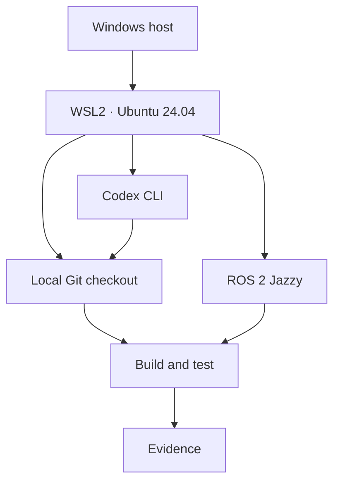
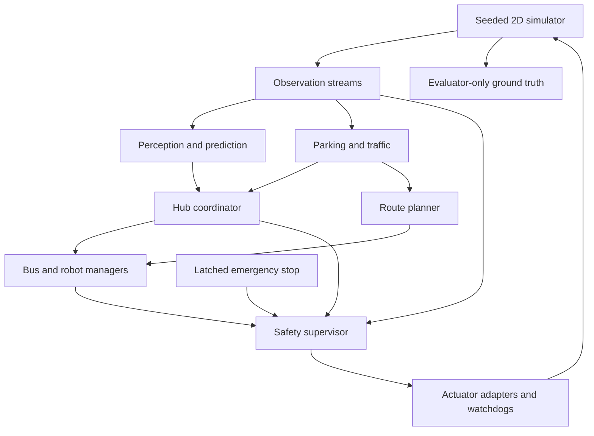
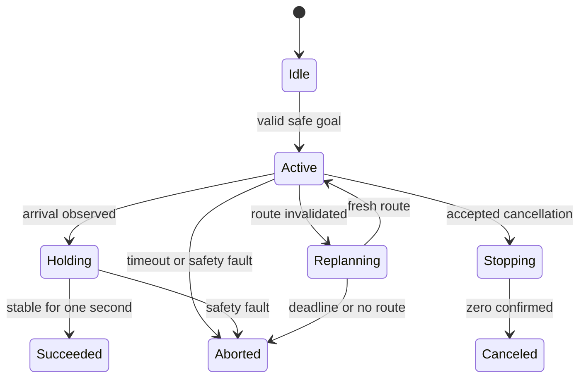
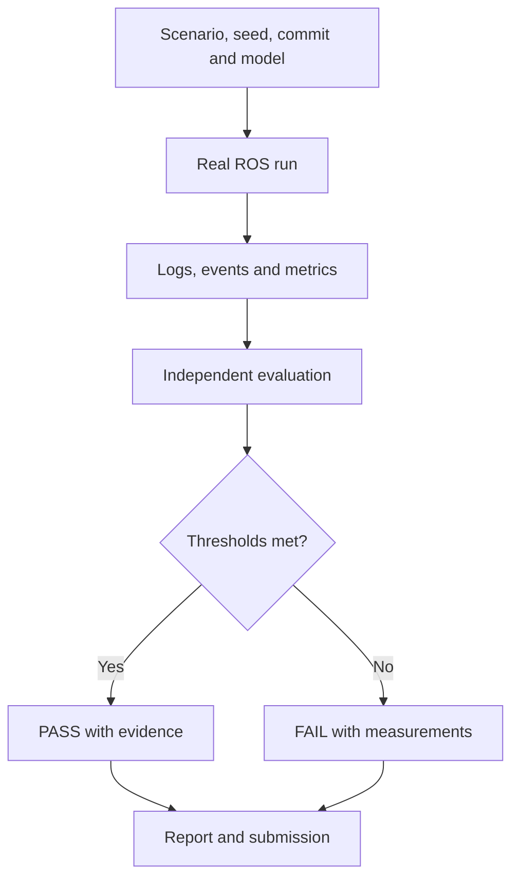

# Proposed architecture

Design target; no nodes have been implemented in this repository.

## Development environment

## Runtime control and observations

Safety is the only final velocity publisher. Ground truth supports evaluation, never perception or planning decisions. Crossing grants are constrained by observed clearance, pedestrians, freshness, and ownership; lease expiry does not prove the crossing is empty.

## Proposed package boundaries

| Package | Responsibility |
|---|---|
| smart_hub_interfaces | Required messages, services, actions |
| smart_hub_sim | M1 map, deterministic world, sensor streams, adapters |
| smart_hub_perception | Tracking, queue and crossing occupancy |
| smart_hub_prediction | Features, persistence, trained regression |
| smart_hub_control | Bus, robot, parking, traffic, planner, coordinator |
| smart_hub_safety | Independent safety authority |
| smart_hub_bringup | Launch, config, scenario runner, logging |
| smart_hub_tests | Unit, ROS integration, scenario and fault evaluation |

Package grouping is a proposal; node responsibilities and published contracts remain authoritative.

## Mission lifecycle

Safety overrides velocity independently of action callbacks. Every terminal path returns a populated result. Rejected requests never enter Active.

## Evidence pipeline

