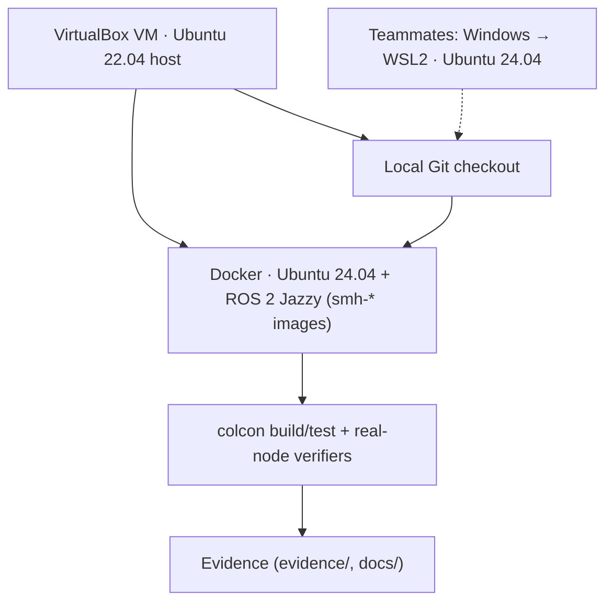
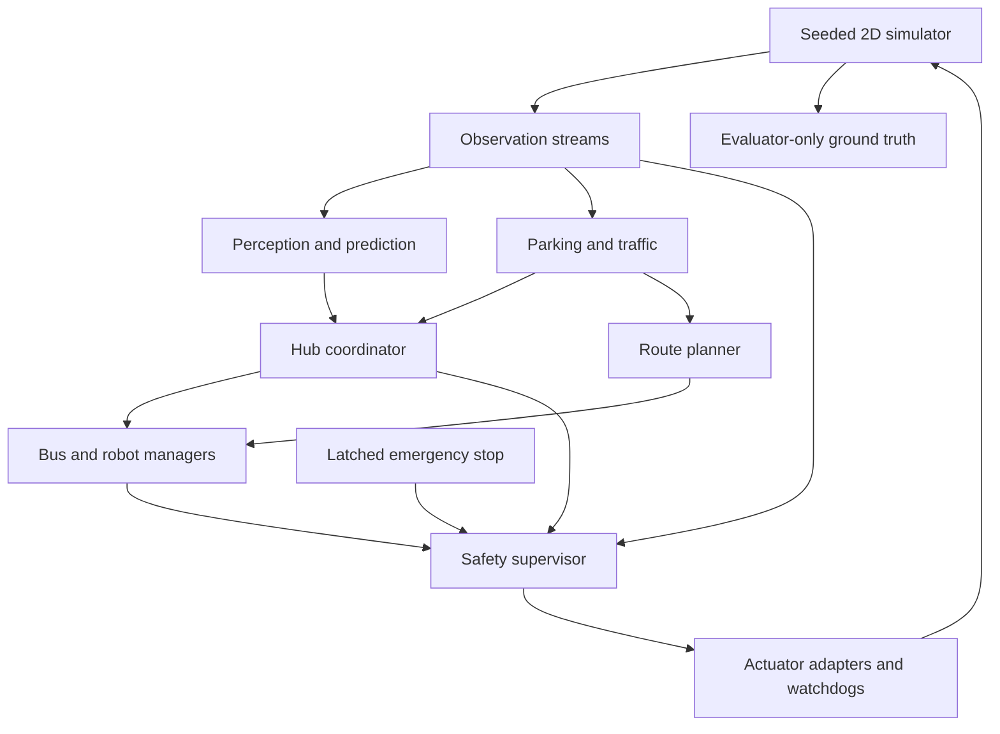
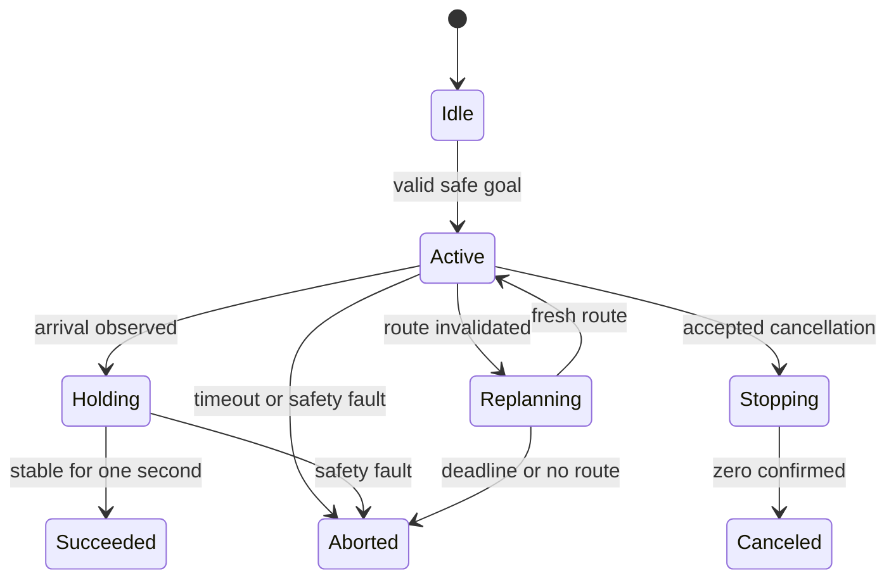
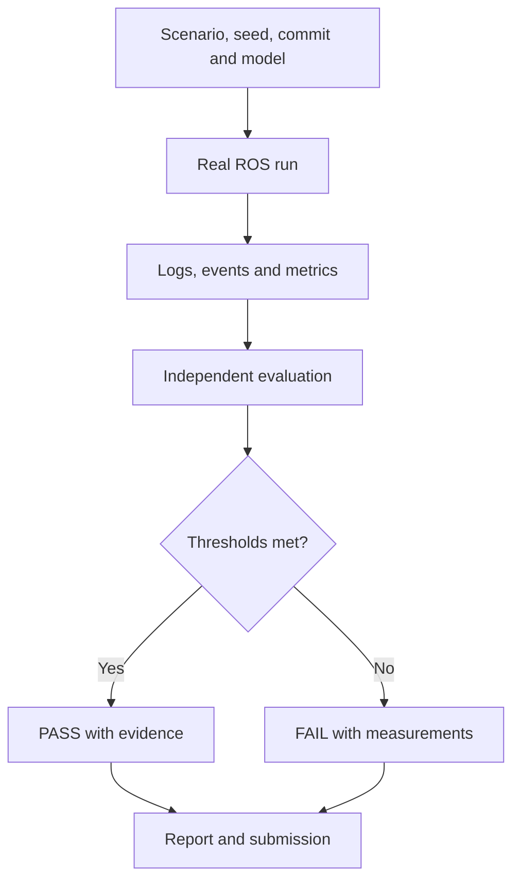

# Architecture

Implemented in part. Ten of the 13 assignment nodes (A §4 pp5–6) exist. `robot_manager`
and `metrics_logger` are missing, and the actuator-bridge role runs inside
`scenario_runner`. See the [node table in the compliance register](compliance.md#required-nodes-a-4-pp56-41-p6-h-51-p11).
The diagrams below are the design. Acceptance status lives in the [test matrix](test-matrix.md).

## Development environment

All local acceptance runs use the container ([M0](m0.md)). The WSL path in
[setup](setup.md) is the documented teammate alternative and has not been executed.

## Runtime control and observations

Safety is the only final velocity publisher. Ground truth supports evaluation, never perception or planning decisions. Crossing grants are constrained by observed clearance, pedestrians, freshness, and ownership; lease expiry does not prove the crossing is empty.

## Package boundaries

| Package | Responsibility |
|---|---|
| smart_hub_interfaces | Required messages, services, actions |
| smart_hub_sim | M1 map, deterministic world, sensor streams, adapters |
| smart_hub_perception | Tracking, queue and crossing occupancy |
| smart_hub_prediction | Features, persistence, trained regression |
| smart_hub_control | Bus, robot, parking, traffic, planner, coordinator |
| smart_hub_safety | Independent safety authority |
| smart_hub_bringup | Launch, config, scenario runner, logging |
| smart_hub_tests | Unit, ROS integration, scenario and fault evaluation |

This multi-package split deviates from the single `smart_hub` package that A §19.1 p26 recommends. The node responsibilities and published contracts are what A grades.

## Mission lifecycle

Safety overrides velocity independently of action callbacks. Every terminal path returns a populated result. Rejected requests never enter Active.

## Evidence pipeline

## M1 package skeletons (historical, 2026-10-22)

All eight proposed package boundaries now exist under `src/`. Interfaces use
ament_cmake/rosidl; the other seven use ament_python with declared dependencies
and resource/package installation metadata. The simulator package installs the
M1 map configuration. No console entry points or placeholder runtime nodes are
installed. The map belongs to smart_hub_sim; safety and adapters remain distinct
future runtime responsibilities. Build and review evidence is tracked in [M1](m1.md).
