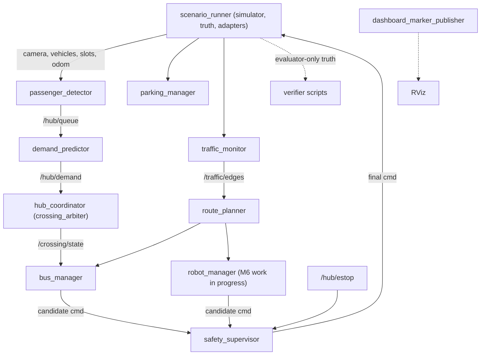
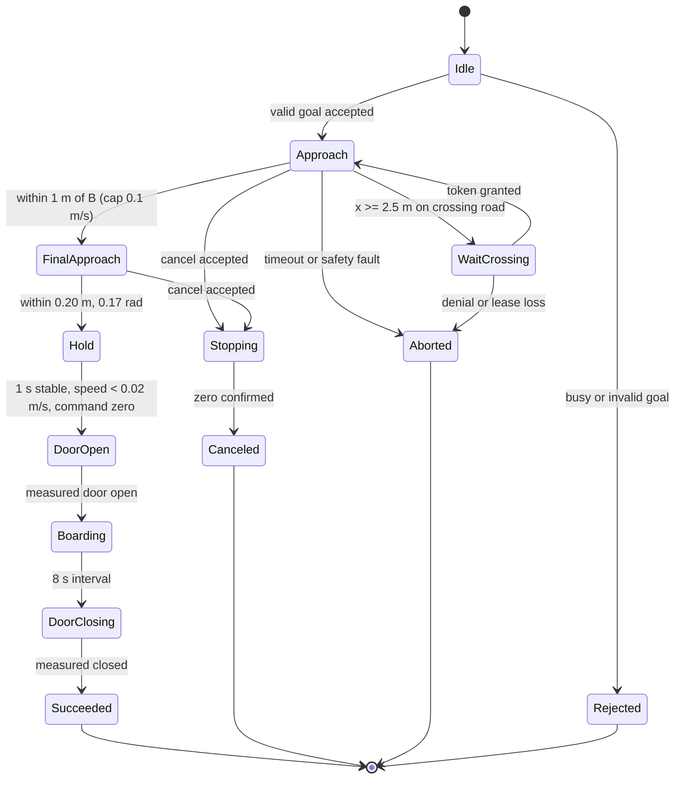
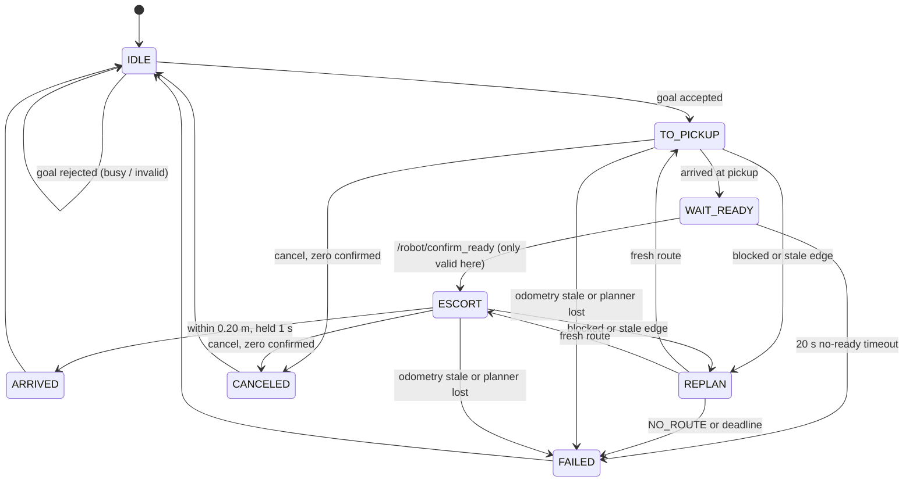
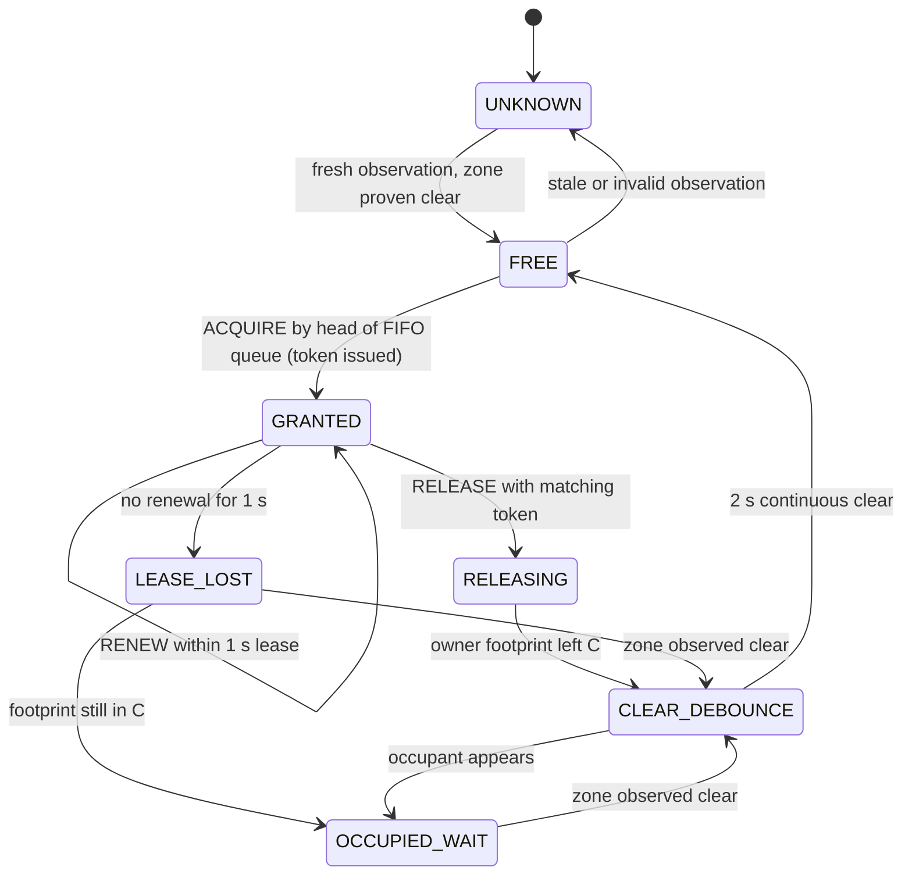
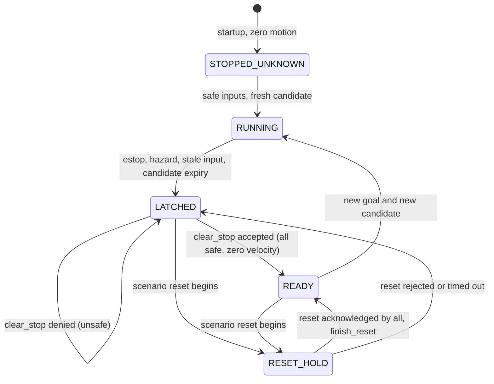

# SME_TEAMNAME_PROJECT_Midterm

**Smart Mobility Hub: ROS 2 Jazzy simulation, final engineering report (first draft)**

| Field | Value |
|---|---|
| Team name | TBD |
| Members | TBD (five members, M1–M5; names not yet assigned) |
| Course / instructor | TBD |
| Submission date | TBD |
| Repository commit of record | TBD (to be fixed when the final run is recorded) |
| Platform | Ubuntu 24.04, ROS 2 Jazzy, Python 3.12.3 with `rclpy` (container); development host is a VirtualBox VM running Ubuntu 22.04 |

Draft status: written 2026-10-25 from the repository documents. Every value comes from a
repository document or evidence file and keeps its original status. Items marked TBD are
unknown. No result in this draft has been upgraded. All results are simulation-only.

Source key: A = assignment PDF, H = implementation handbook (guidance only), N = newer
instructor announcement (overrides only submission and video rules).

---

## 1. Requirements summary

The assignment (A) defines what is graded. Section numbers and printed page numbers refer to A.
The full traceability table is `docs/requirements.md`; the per-section implementation register
is `docs/compliance.md`.

### 1.1 Scenarios S1–S9

| ID | Source | Required behavior | Node | Tests |
|---|---|---|---|---|
| S1 | A §8 p14 | Passenger tracking, foot-point queue counting in Q, crossing occupancy, 0.4 s debounce, 0.5 s occlusion, invalid output within 1.2 s of a feed freeze; at least 100 annotated real-video frames with count MAE of 1 person or less | passenger_detector | T01, T02 |
| S2 | A §9 p15 | At least 30 six-minute episodes split 60/20/20 by episode; 30 s demand forecast; ridge model against persistence; inference p95 under 100 ms; dispatch hysteresis and fallback; reactive versus predictive comparison | demand_predictor, hub_coordinator | T03, T04 |
| S3 | A §10 p16 | Bus docking: DockBus action, crossing acquire/renew/release, stopped-door interlock (8 s door interval), 10/10 nominal, ETA | bus_manager | T05, T06 |
| S4 | A §11 p17 | Atomic, idempotent parking reservations; expiry; barrier interlock; 20 concurrent request pairs; service p95 under 250 ms | parking_manager | T07, T08 |
| S5 | A §12 p18 | Edge speed and density; NORMAL, CONGESTED, BLOCKED and UNKNOWN labels with timing bounds; ten free-flow runs | traffic_monitor | T09, T10 |
| S6 | A §13 p19 | Cost-aware Dijkstra, replanning rule, explicit NO_ROUTE, 20-seed oracle check, p95 under 250 ms | route_planner | T11, T12 |
| S7 | A §14 p20 | Robot escort: readiness (20 s), navigation, obstacle handling, cancellation, 10/10 nominal | robot_manager | T13, T14 |
| S8 | A §15 p21 | Timed integration over 0–300 s, ten paired predictive/reactive seeds, zero collisions and crossing conflicts | hub_coordinator and all | T15 |
| S9 | A §16 p22 | Fault map, latched stop, independent watchdogs, deliberate reset, five phase-varied repetitions | safety_supervisor, adapters | T16, T17, T18 |

### 1.2 Tests T01–T18

The acceptance text for each test is in `docs/test-matrix.md` (source: A §21 pp29–30 and the
scenario sections above). Section 9 of this report gives their status.

### 1.3 Cross-cutting requirements

| ID | Source | Requirement |
|---|---|---|
| R01 | A §§1–4 pp2–6 | Deterministic Python/rclpy simulator at 20 Hz; M1 geometry and agent constraints |
| R02 | A §§5–7 pp7–13 | Exact topics, messages, services, actions, rates, QoS and frames |
| R03 | A §17 p23 | Exposed, range-validated scenario parameters with a final dump per run |
| R04 | A §21 pp29–30 | Actual metrics, repeatable runs, independent evaluation |
| R05 | A §24 pp33–34; N | Report, direct uploads, source/data ZIP, individual contributions |
| R06 | N | 20–30-minute all-member video (replaces the 8-minute demo in A §24.1 p33) |
| R07 | N | At most 10 files, each at most 1 GB, no external links, leader uploads and others validate |

Known source discrepancies and how they were resolved (`docs/compliance.md`): the readiness
service follows A §14.1 (the button or dashboard is the Trigger client; H §4.7 phrases it the
other way); the demo duration follows N; traffic monitoring is listed under both M3 and M5 in A
(H §7.1 treats M3 as algorithm owner and M5 as simulator-input owner).

---

## 2. Coordinate map M1 and graph

The map is defined in `src/smart_hub_sim/config/map_m1.yaml` (frame `map`; metres and radians;
x east, y north, z up; bounds x in [0, 12], y in [0, 8]).

Source of the geometry: A §§2–3 pp3–4. The coordinates of the derived nodes N, Cn, Cs, J and U
are design choices approved in the M1 plan and corroborated by H Appendix A Listing A.1
(p20). They are not attributed to A's coordinate table. W = (5, 6) is defined in A §3.1.

**Nodes (m).** A (1,2), E (11,2), B (8,4), R (3,6), D (9,1), W (5,6), N (1,4), Cn (5,4),
Cs (5,2), J (9,2), U (11,4), parking slots P1 (8,6.5), P2 (9.5,6.5), P3 (11,6.5).

**Zones.** Crossing zone C: x in [4.5, 5.5], y in [1.25, 4.75]. Passenger queue zone Q: x in
[2, 6], y in [5, 7]. Obstacle O: centre (7, 2), radius 0.35 m, injected by scenario control
only and never present at startup.

**Graph.** The graph is undirected with 15 edges. Edge IDs are the lexicographically sorted
endpoint names joined by a hyphen (for example `A-Cs`, `Cn-W`). Each edge lists its permitted
agents explicitly (bus, car, robot). Robot-only edges include R-W, Cn-W and Cn-Cs. Edge
lengths are Euclidean.

**Crossing ownership.** Every edge whose segment intersects zone C needs a crossing token.
Exact geometric intersection finds six such edges, one more than the five A §3.1 names: W-Cn
also qualifies because Cn lies inside C. All six are treated as crossing edges (decision
recorded in `docs/m1.md`).

**Static checks (M1, PASS):** 15 edges, 10 m and 14 m route-length checks, six crossing
intersections. Static geometry does not prove swept-footprint collision avoidance; that is a
runtime obligation of the simulator and crossing arbiter.

**M4 defaults added to the map file (user-approved):** car speed 0.35 m/s, minimum headway
0.80 m.

TBD: a rendered map figure (not yet produced).

---

## 3. ROS graph and node responsibilities

Source of the node list: A §4 pp5–6 and §4.1 p6. Ten of the 13 assignment nodes exist as
named. The repository splits the code into eight packages (`smart_hub_interfaces`, `_sim`,
`_perception`, `_prediction`, `_control`, `_safety`, `_bringup`, `_tests`) instead of the
single `smart_hub` package recommended in A §19.1 p26. This is a recorded deviation; A grades
node responsibilities and published contracts.



### 3.1 Assignment nodes against the implementation

| A node | Implemented as | Status |
|---|---|---|
| scenario_runner | `smart_hub_sim` `scenario_runner` | Implemented. Owns the public `/scenario/reset`, world, private truth, seeded events |
| passenger_detector | `smart_hub_perception` | Implemented (synthetic tracks, homography, debounced tracker, offline NanoDet backend) |
| demand_predictor | `smart_hub_prediction` | Implemented (persistence and ridge model) |
| bus_manager | `smart_hub_control` | Implemented |
| parking_manager | `smart_hub_control` | Implemented |
| traffic_monitor | `smart_hub_control` | Implemented |
| route_planner | `smart_hub_control` | Implemented |
| robot_manager | `smart_hub_control/robot.py` | NOT IMPLEMENTED in the compliance register (2026-10-25 snapshot). Work in progress on branch `feat/m6-robot-manager`, not accepted (see section 9) |
| hub_coordinator | executable `crossing_arbiter`, ROS node name `hub_coordinator` | DEVIATION, naming only: the executable name differs from A, the node name matches |
| safety_supervisor | `smart_hub_safety` | Implemented |
| actuator_bridge | inside `scenario_runner` (`_active_command`) | DEVIATION: command expiry and supervisor-loss watchdog run in the simulator process, not in a separate node. A separate bridge is still needed before any hardware binding (A §22 p31) |
| metrics_logger | none | NOT IMPLEMENTED. Verifier scripts write JSON records instead; run-level CSV logging (A §21.2 p30) is missing |
| dashboard_marker_publisher | `smart_hub_bringup` | Implemented, no control authority; marker coverage and RViz evidence NOT RUN |

The register above reflects the compliance document. The `robot_manager` row must be updated
when the M6 result is recorded (TBD).

### 3.2 Design rules visible in the graph

- Safety is the only final velocity publisher. `safety_supervisor` publishes `/bus/cmd_vel` and
  `/robot/cmd_vel`; mission nodes publish only candidates.
- Evaluator-only ground truth (`/sim/evaluator/ground_truth`) is never subscribed to by control
  nodes. Noisy observations (pose noise bounded uniform at +/-0.02 m per axis and +/-0.01 rad
  yaw; synthetic design choices) are the only control inputs.
- One transform authority per frame edge (map to robot/odom to robot/base_link, and the bus
  equivalent).
- Time: wall-backed ROS time for acquisition stamps and monotonic time for receipt ages,
  leases and latency. There is no `/clock` publisher and `use_sim_time` is not enabled.

---

## 4. Interface rationale

Source: A §§5–7 pp7–13. The 14 messages, six services and three actions are transcribed in
`src/smart_hub_interfaces` (23 definitions; M1 build and `ros2 interface show` of all 23:
PASS). The field register is `docs/contracts/m1-fields.json`; endpoint tables are in
`docs/interfaces.md`.

### 4.1 Topics, services or actions

| Mechanism | Used for | Why |
|---|---|---|
| Topic | Periodic observations and state (queue, vehicles, parking, edges, crossing, odometry, safety), candidate and final velocity | Continuous data with rate contracts; subscribers must tolerate loss and age the data themselves |
| Service | Short request/response: reserve/release slot, compute route, request crossing, reset, clear stop, confirm ready | Bounded transactions with an explicit success or failure reply; 250 ms target and 1 s client timeout (A §7.1 pp10–11) |
| Action | Long missions: DockBus, EscortPassenger, NavigateTo | Feedback at 2 Hz, cancellation, and an always-populated terminal result (A §7.2 p12) |

### 4.2 QoS and rates

Custom types come from `smart_hub_interfaces`. R = reliable/volatile; number = keep-last depth;
T = transient-local.

| Topic | Rate | QoS |
|---|---|---|
| /camera/image_raw | 10 Hz | sensor-data |
| /hub/queue | 5 Hz | R, depth 10 |
| /hub/demand | 1 Hz | R, depth 10 |
| /hub/vehicles | 10 Hz | R, depth 10 |
| /hub/bus_arrival | 2 Hz | R, depth 10 |
| /parking/observed | 5 Hz | R, depth 10 |
| /parking/state | 2 Hz and on change | R, depth 1, T |
| /traffic/edges | 2 Hz | R, depth 10 |
| /crossing/state | 10 Hz | R, depth 1, T |
| /robot/odom, /bus/odom | 20 Hz | R, depth 10 |
| /robot/cmd_vel_candidate, /bus/cmd_vel_candidate | 20 Hz | R, depth 1 |
| /robot/cmd_vel, /bus/cmd_vel | 20 Hz | R, depth 1 |
| /hub/estop | event and 10 Hz | R, depth 1, T |
| /hub/safety | 10 Hz | R, depth 1, T |
| /hub/events | on change | R, depth 100 |
| /hub/markers | 5 Hz | R, depth 10 |

`/bus/odom` is not in A's table; it mirrors `/robot/odom` (M2 design choice). Real-node
`ros2 topic hz` evidence for every topic is NOT RUN.

Auxiliary interlock topics (door and barrier request/status) are reliable, volatile, depth 1.
A gives no numeric status rate, so the 10 Hz measured status with a 0.5 s receipt watchdog is a
declared design choice. `Bool` carries no source stamp, so freshness is judged by local receipt
age.

### 4.3 Frames and timestamps

- World frame `map`. Odometry uses `robot/odom` with child `robot/base_link` (bus equivalents).
  Candidate `TwistStamped` uses the agent base frame; final `Twist` is read in that frame.
- Observation stamps are acquisition time, never republish time. Nested records share the
  array's acquisition stamp; an array header must never hide a stale individual record.
- Future stamps are rejected with zero tolerance (user-approved M2 choice).
- Invalid or stale input is UNKNOWN (queue confidence under 0.5, stale parking slot, stale edge),
  never a fabricated zero or clear. ETA is meaningful only when `eta_valid`; invalid ETA is -1.

### 4.4 Internal endpoints (not in A)

Reset participants use the existing `ResetScenario` schema: `/safety/reset_state`,
`/safety/finish_reset`, `/crossing/reset_state`, `/sim/reset_world`, `/parking/reset_state`,
`/traffic/reset_state`. The public `/scenario/reset` stays in `scenario_runner`.

---

## 5. State machines

### 5.1 DockBus (S3, A §10 p16)

The state names below are a summary of the behavior documented in `docs/m3.md`; exact internal
state identifiers are TBD (to be copied from `src/smart_hub_control`).



Policies: cruise cap 0.4 m/s, final 1 m cap 0.1 m/s; rotation only while stopped at graph
nodes; the door request is issued only after a confirmed zero command, and propulsion needs a
measured closed door.

### 5.2 Escort (S7, A §14 p20)

Implemented in `smart_hub_control/robot.py` on branch `feat/m6-robot-manager`; not accepted.



The REPLAN and failure states are summarized from `docs/mandatory-scenarios-progress.md`; the
exact names are TBD.

### 5.3 Crossing arbitration (A §10, §15.2, §18.4)



State names are descriptive (the exact message enumeration is TBD). Key rules: grants are FIFO;
the lease is 1 s with renewal; an expired lease never proves the crossing empty; lease loss
restarts the 2 s clear debounce; the simulator independently inhibits entry while another
physical footprint is inside C; crossing clearance inflates observed footprints by the maximum
position error (sqrt(2) x 0.02 m) plus travel since acquisition.

### 5.4 Safety latch and reset (S9, A §16 p22)



Clearing the latch never restarts a mission: old candidates are discarded and a newly stamped
candidate and a new goal are required. The exact enumeration of supervisor states is TBD.

---

## 6. Prediction and data split

All values in this section are offline fixture evidence from
`src/smart_hub_prediction/models/ridge.json` (schema `smart-hub-ridge-v1`). They are not ROS
acceptance of T03.

| Item | Value |
|---|---|
| Episodes | 30 synthetic episodes (seeds 1000–1029) |
| Split | By whole episode before windowing: 18 train (1000–1017), 6 validation (1018–1023), 6 test (1024–1029) |
| History / horizon | 60 s history, 30 s horizon |
| Model | Ridge regression, penalty 0.1, 9 coefficients |
| Baseline | Persistence on the same test targets |

| Split | Samples (windows) | Model MAE | Model RMSE | Persistence MAE | Persistence RMSE |
|---|---|---|---|---|---|
| Validation | 1626 | 3.393 | 4.209 | 10.737 | 13.473 |
| Test | 1626 | 3.333 | 4.161 | 9.841 | 12.109 |

Test MAE of the model (3.33) is below persistence (9.84) on 1626 windows. Leakage prevention:
episodes are assigned to a split before any window is cut, and test seeds are unseen during
training and validation.

Not done or not run:

- T03 in ROS: inference p95 under 100 ms is NOT RUN (no latency was measured).
- T04 dispatch hysteresis: NOT RUN.
- Reactive versus predictive waiting-time comparison: NOT RUN.
- H §4.2 asks for one documented case where the model performs worse than persistence: NOT DONE.
- The data are synthetic fixtures generated by the simulator; no real demand data were used.
- Standard deviation or confidence intervals over seeds: TBD.

---

## 7. Safety policy

### 7.1 Authority and independence

All bus and robot motion passes through the independent `safety_supervisor` (20 Hz candidate
validation and final commands; 10 Hz `/hub/safety`). Mission nodes cannot publish final
velocity. The actuator adapter (inside `scenario_runner`) independently stops on command
expiry and on loss of the supervisor, so a dead supervisor and a dead controller are two
separate stop paths (A §16; AGENTS.md).

### 7.2 Watchdogs and limits

| Item | Value | Source |
|---|---|---|
| Command timeout | 0.5 s | A §3.3 p4 |
| Stop latency bound | 0.20 s from supervisor receipt to zero command | A §16.3 |
| Source freshness | 1.0 s | A §3.3 p4 |
| Angular speed cap | 1 rad/s | user-approved M2 choice |
| Future stamp tolerance | 0 s | user-approved M2 choice |
| E-stop, door, crossing, supervisor heartbeat watchdogs | 0.5 s receipt | M2 design choice |
| Adapter stop after supervisor loss, verifier bound | 0.65 s | derived: 0.5 s timeout + 0.05 s step + truth sampling (no margin) |
| Measured stop | exactly zero simulated velocity | user-approved M2 choice |

Safety limits may be reduced by parameters but never raised above the assignment caps; ranges
are checked at startup.

### 7.3 Latch and reset handshake

- Startup is zero motion; so is the state after any protective stop.
- The E-stop latch persists after a false input; `clear_stop` is denied while a hazard, stale
  input, asserted stop or nonzero motion exists; clearing permits readiness only and never
  restarts a mission.
- Public `/scenario/reset` (owned by `scenario_runner`) awaits all participants under one
  monotonic deadline: safety prepare, crossing, parking and traffic where launched, bus and
  robot prepare, then `/sim/reset_world`, then finish. It rejects unknown scenarios, asserted
  stop, stale inputs, hazards, nonzero motion and busy resets, and returns explicit outcomes
  (busy, unavailable, denied, timeout).
- Since the M6 work, independent participants run concurrently (robot and bus prepare;
  parking and traffic; bus and robot finish).

### 7.4 Decisions D09–D11 (`docs/decisions.md`)

| ID | Decision | Reason | Status |
|---|---|---|---|
| D09 | Public reset uses an internal 0.9 s deadline | A §7.1 p10 sets a 1 s client timeout; a failure must reach the client before it | Adopted 2026-10-25 (`038695b`); M2 still FAIL at that commit |
| D10 | Evaluator-only ground truth published every 20 Hz simulator step | Finer stop-time measurement; the topic has no assignment rate; `/hub/vehicles` stays 10 Hz | Adopted 2026-10-25 (`038695b`) |
| D11 | `reset_deadline_sec` parameter: 0.9 s for the M2 graph, 2.0 s (maximum) when bus and robot mission managers participate | A sets no reset deadline; 0.9 s is derived from the generic 1 s client timeout. The 8-participant M6 handshake measured 0.83 s through four of six stages on the development VM | User decision 2026-10-25; verifier reset clients wait 3 s |

Note: D11 sets a reset deadline that exceeds the 1 s generic client timeout once mission
managers participate. This is a documented project choice, not an assignment value.

---

## 8. Other algorithms (brief)

- **Parking (S4):** one lock for allocation; allocate only fresh FREE slots; TTL 5–120 s;
  unique tokens; one slot per vehicle; identical retries return the original result;
  expiry never frees a physically occupied slot; barrier opens only for the matching owner,
  fresh clear entrance and a fresh measured status.
- **Traffic (S5):** speed is the median of current tracks over 5 s; density is distinct current
  vehicles over capacity `K = floor(max(0, L - 2r) / headway) + 1` (r = 0.30 m, headway
  0.80 m); UNKNOWN when valid observations are lost; free-flow speed 0.35 m/s.
- **Routing (S6):** Dijkstra with an edge-cost formula including a fresh crossing-wait term;
  explicit NO_ROUTE; retries bounded with backoff.
- **S1 perception:** four-point homography, foot-point counting, debounce 0.4 s, occlusion
  retention 0.5 s, freeze invalidation; offline NanoDet backend (OpenCV Zoo ONNX asset pinned,
  Apache-2.0 license file kept). Video evaluation needs team-supplied annotated frames.

---

## 9. T01–T18 results

Status is copied from `docs/test-matrix.md` and `docs/mandatory-scenarios-progress.md`
(snapshot 2026-10-25). Vocabulary: PASS = measured evidence met acceptance on a recorded run;
FAIL = a recorded run missed it; NOT RUN = implemented but acceptance not executed; BLOCKED =
cannot run until a prerequisite exists. Historical PASS results do not certify later commits.
Mocks and pure Python tests do not establish ROS integration.

Context for T05–T10 evidence: the combined local run at `58f5afee4bd53567634f022d836c6a94f5daeaa7`
passed M2 18/18, M3 24/24 and M4 9/9 after a fresh build and 54 package tests. A same-commit
repeat passed M2 and failed M3 at nominal seed 309 (`SAFETY_INPUT_UNKNOWN:estop_stale`); T06 and
M4 were NOT RUN in that repeat. On the current branch M2 is FAIL (17/18 at `038695b`).

| ID | Area | Status (as recorded) | Measured values and evidence |
|---|---|---|---|
| T01 | S1 counting | NOT RUN | none |
| T02 | S1 occlusion/stale | NOT RUN | none |
| T03 | S2 prediction | NOT RUN | Offline fixture only (section 6): test MAE 3.333 vs persistence 9.841 on 1626 windows. Not T03 acceptance |
| T04 | S2 dispatch | NOT RUN | none |
| T05 | S3 docking | Historical PASS at 58f5afee (10/10); same-commit repeat FAIL (9/10, seed 309 estop_stale); later receipt-duration FAIL (4/5 attempted, seed 304 at 7.973234 s); candidate 67caa06 M3 NOT RUN after M2 FAIL | Max position error 0.05 m in one ten-run set (limit 0.20 m); door-open intervals 8.096 to 8.207 s in that set (`docs/m3.md`). Evidence: `evidence/m234-combined-20261025.json`, `evidence/m234-repeat2-20261025.json`, `evidence/m234-node-boundary-fix-20261025.json`, `evidence/door-validation-completion-20261025.json` |
| T06 | S3 cancellation | PASS first run; harness cancel-during-approach PASS (0.146 s); overall harness verifier FAIL on two cases | Zero command after cancel in 0.146 s (harness, one sample). `evidence/m3-operator-isolation-20261025.json`. Earlier first-run values 0.138 s and 0.191 s are in `docs/m3.md` |
| T07 | S4 atomicity | PASS first run; NOT RUN in repeat (independent review pending) | Service p95 and sample count: TBD (not transcribed in the matrix). `evidence/m4-local-completion.json`, `evidence/m234-combined-20261025.json` |
| T08 | S4 expiry | PASS first run; NOT RUN in repeat (independent review pending) | none transcribed. Same evidence as T07 |
| T09 | S5 congestion | PASS first run; NOT RUN in repeat (independent review pending) | none transcribed. Same evidence as T07 |
| T10 | S5 stale | PASS first run; NOT RUN in repeat (independent review pending) | none transcribed. Same evidence as T07 |
| T11 | S6 routing | NOT RUN | Debug run on the M6 branch: 60 requests over 20 configurations matched the oracle, p95 0.066 s. This was before a reachable-node fix and is not an acceptance run, so the status stays NOT RUN. [M6 full run result pending] |
| T12 | S6 no route | NOT RUN | [M6 full run result pending] |
| T13 | S7 escort | NOT RUN | One debug escort `nominal_escort_01` on 8 vCPUs: final error 0.04 m max over 1 s, final speed 0, 0 conflicts in 614 inside-C samples, feedback interval p50 0.500 s / p95 0.503 s / max 0.522 s, mission time 97 s. This is one run, not T13. [M6 full run result pending] |
| T14 | S7 lifecycle | NOT RUN | [M6 full run result pending] |
| T15 | S8 integration | NOT RUN | none (compliance register: NOT IMPLEMENTED at the 2026-10-25 snapshot for car scenarios, robot missions and metrics aggregation) |
| T16 | S9 stop latch | NOT RUN | M2 prerequisite probe only (not T16): E-stop latency 0.035 to 0.079 s in `evidence/mandatory-m2-038695b.json`; per-trial count TBD |
| T17 | S9 watchdog | NOT RUN | M2 prerequisite probe only (not T17): adapter stop after supervisor loss 0.44 to 0.63 s against a 0.65 s bound in `evidence/mandatory-m2-038695b.json`; trial count TBD |
| T18 | S9 service loss | NOT RUN | none |

Counts of recorded statuses: 0 current PASS rows without qualification; T05 and T06 hold a
historical first-run PASS; T07 to T10 hold a first-run PASS; T05 and the harness verifier also
record FAIL; T01 to T04 and T11 to T18 are NOT RUN.

[M6 full run result pending]: the full `scripts/verify_m6.py` run (10 escorts, T14 cases, T12,
T11) had been started; its result file (`.cache/m6full/run1.json`) is not recorded in the
repository. T11 to T14 remain NOT RUN until it is recorded.

M2 prerequisite probes are a separate gate: FAIL, 17/18 at `038695b`
(`evidence/mandatory-m2-038695b.json`). Last full PASS was 18/18 at `58f5afee`, historical.

Not yet available: per-row configuration hash, model ID, start/end times and machine
specification as required by the result template in `docs/test-matrix.md`: TBD.

---

## 10. Failures and diagnoses

The assignment rubric (A §24.2) requires failed tests to stay in the report with a diagnosis.

| # | Failure | Observed | Diagnosis | Status |
|---|---|---|---|---|
| F1 | M3 nominal seed 309, same-commit repeat | `SAFETY_INPUT_UNKNOWN:estop_stale` at the tenth nominal case; T05 9/10, T06 and M4 NOT RUN | The supervisor saw a stale E-stop input (cause of the staleness not established). A later harness-only run passed all ten nominal seeds including 309 but failed two other cases (22/24). Root cause not fully proven; repeatability open | Open |
| F2 | M3 seed 304, door-open interval | 7.973234 s against the 8.0 s threshold; prior same-seed runs measured 8.201097 s and 8.118734 s | Physical cause remains unproven. An earlier dwell-timing and margin recommendation was withdrawn; controller timing was left unchanged. Door measurement controls later passed with source bounds 8.125094930 to 8.125098802 s and a separately retained 8.091999096 s receipt duration; the gate now uses conservative source bounds | Open; clean acceptance not completed |
| F3 | Earlier `5e9757b` run | `crossing_stale` failure | Shared-Cn-node deadlock in the simulator was corrected. A follow-up recovery attempt exposed a guard/release mismatch: the bus released ownership while its movement guard still required it, waited at x=6.247 m for 68.803 s, then stopped on `crossing_stale`. Release rule aligned with the guard; the recovery case then passed in 67.773 s and 14 focused unit tests passed | Targeted fix verified; full suite not closed |
| F4 | M2 on current branch, reset deadline | `scenario_reset_acceptance` seed 99 reached `RESET_DEADLINE` at 0.951 s against 0.9 s; 17/18 | Host load average 8.3 to 12.8 on 18 vCPUs with desktop and IDE active. Reset deadline rework (D09) and concurrent participants followed | See F5 |
| F5 | VM vCPU timing on the development host | On 18 vCPUs, single reset hops took 0.11 to 0.57 s at load 3 to 11 and the full 8-participant reset took 0.9 to 2.1 s; every case starting with a scenario reset failed | VirtualBox vCPU over-allocation (VirtualBox on Hyper-V scheduling), not the reset logic. After reducing the VM to 8 vCPUs the full 8-participant reset completed in 0.012 to 0.017 s with load average below 1.1. Timing runs must use 8 vCPUs. Details in `docs/vm-host-repair.md` | Mitigated on the VM; M2 and M3 acceptance must be re-run (TBD) |
| F6 | Adapter stop bound | Two earlier runs missed the 0.65 s bound by 1 to 9 ms (0.651 s and 0.659 s) | The bound has no margin: 0.5 s command timeout + 0.05 s step + truth sampling. No threshold changed; profile `scenario_runner` step jitter if it recurs | Open |
| F7 | Robot heading at W | Robot turned north at W (`copysign(pi/2, 0.0)`) and timed out | Heading is now chosen by the dominant axis (fixed in `1218e30`). `bus.py` has the same rule but never approaches a turn horizontally on its route, so it was left unchanged | Fixed; one debug escort PASS afterwards (not T13) |
| F8 | Parking freeze fault (M4) | Simulator acquired one extra parking frame after a freeze request | Now repeats the last acquisition immediately; regression test added; freshness policy unchanged | Fixed |
| F9 | First M2 attempt on the mandatory branch | 15/18; E-stop probe saw no motion; missing-participant probe timed out; bus stopped before entering C; one reset trace at 1.052 s | Verifier leftovers and reset ownership; addressed in `038695b` | Superseded by F4 |
| F10 | OpenCV container image build | Cancelled during layer export to save local budget | NanoDet ONNX load and real video evaluation are therefore unverified | Open |

Additional process failures: several incremental or isolated-cache door-validation builds
failed on cache mounts or style findings (`docs/door-measurement.md`); no historical test
status changed because of them.

---

## 11. Limitations

From `docs/compliance.md` (snapshot 2026-10-25); update when the M6 result is recorded.

NOT IMPLEMENTED or missing:

- `robot_manager` servers (`/robot/navigate_to`, `/robot/escort`) and the `/robot/confirm_ready`
  Trigger are NOT IMPLEMENTED in the register; a work-in-progress implementation exists on
  `feat/m6-robot-manager` and is not accepted. This blocks S7, S8 and T13 to T15.
- Car scenarios, robot missions and metrics aggregation for S8.
- `metrics_logger` node and per-run CSV logging (A §21.2 p30).
- Scenario files `scenarios/S1.yaml` to `S9.yaml` (events are ROS parameters); a launch with
  `scenario`, `seed` and hardware/simulation mode arguments (A §20.1 p28; `integrated.launch.py`
  declares only `seed`); team `ROS_DOMAIN_ID` (verifiers use explicit domains).
- Named parameters `reservation_ttl_sec`, `congestion_density_threshold` and
  `replan_improvement_ratio` (A §17 p23). Final parameter dumps are captured by verifiers for
  some nodes only.
- Representative rosbag recordings and replay isolation (A §20.2 p28): NOT RUN.
- `launch_testing` integration tests: custom real-process verifiers are used instead
  (`verify_m2.py`, `verify_m3.py`, `verify_m4.py`, `verify_s1.py`, `verify_m6.py`).
- Separate actuator bridge node (needed before any hardware binding).

BLOCKED:

- Video demonstration of S1: needs team-supplied lawful video with at least 100 annotated
  frames; none exists.
- Independent human review and teammate reproduction: the repository has one contributor.
- Fresh-checkout reproduction: not completed.

Scope limits:

- Simulation only; optional hardware, Gazebo and Nav2 are not started (AGENTS.md).
- Prediction metrics are offline fixture evidence on synthetic data.
- M2, M3 and M4 repeatability is unestablished; the first combined PASS is historical.
- Real-node topic-rate evidence and RViz marker coverage are NOT RUN.
- The development host differs from the target (Ubuntu 22.04 VM with a 24.04/Jazzy container);
  timing results depend on the vCPU setting (section 10, F5).
- No hosted CI results are claimed as assignment evidence; hosted CI is optional tooling.

---

## 12. Reproduction instructions

Verification runs in an Ubuntu 24.04/Jazzy Docker container (`smh-m4-local`) on the development
host; see `docs/m0.md`, `docs/setup.md` and `docs/automation.md`. Use an ordinary user, never root.

Build (from the repository root):

```sh
docker run --rm --user "$(id -u):$(id -g)" -e HOME=/tmp \
  -v "$PWD:/workspace" -w /workspace smh-m4-local bash -lc \
  'source /opt/ros/jazzy/setup.bash && colcon --log-base .cache/log build \
   --base-paths src --build-base .cache/build --install-base .cache/install --symlink-install'
```

Test (inside the same container, after `source .cache/install/setup.bash`):

```sh
python3 scripts/verify_m2.py --output <file>.json
python3 scripts/verify_m3.py        # S3
python3 scripts/verify_m4.py        # S4 and S5
python3 scripts/verify_m6.py        # T11 to T14; supports --case NAME
```

Launch files are in `src/smart_hub_bringup/launch/`: `m2`, `m3`, `m4`, `m6`, `integrated`
(argument `seed`) and `s1_counting`. Package quality checks (ament_flake8, ament_pep257) run
through `colcon test`, then `colcon test-result --verbose`.

Image build commands for `smh-m4` and `smh-m4-local` are in `docs/m3.md` and
`containers/Dockerfile`, `containers/Dockerfile.local`. Teammate WSL2 path: `docs/setup.md`
(not executed).

Reproduction notes:

- Keep the VM at 8 vCPUs for timing runs (section 10, F5).
- Record the commit, image ID, seed list and parameter dump with every run.
- A fresh-checkout reproduction by a second person: TBD (BLOCKED).
- Commands above come from the README; the exact arguments of `verify_m3.py`, `verify_m4.py`
  and `verify_m6.py` for the final run: TBD.

---

## 13. Contribution table

Roles follow A §23.2 p32 as recorded in `CONTRIBUTING.md`. Names, dates, issue/PR/commit
references, tests executed, evidence reviewed, report sections and video segments are TBD for
every member. Commit counts alone do not measure contribution.

| Member | Name | Primary scope (A §23.2) | Reviews / demonstrates | Commits / PRs | Tests executed | Report sections | Video segment |
|---|---|---|---|---|---|---|---|
| M1 | TBD | Detector, tracking, demand features, model training, S1/S2 experiments | Reviews M3 state validity; explains leakage prevention | TBD | TBD | TBD | TBD |
| M2 | TBD | Coordinator, bus manager, dispatch hysteresis, crossing arbitration, S3/S8 | Reviews M4 cancellation; explains resource ownership | TBD | TBD | TBD | TBD |
| M3 | TBD | Parking manager, idempotency, traffic monitor, S4 concurrency tests | Reviews M1 data labels; explains atomic updates | TBD | TBD | TBD | TBD |
| M4 | TBD | Map graph, route planner, robot manager, S6/S7 tests | Reviews M2 crossing logic; demonstrates blocked-route recovery | TBD | TBD | TBD | TBD |
| M5 | TBD | Simulator, traffic monitor (simulator inputs), safety, launch, actuator adapter, S5/S9 | Reviews integrated failures; demonstrates watchdog and reset | TBD | TBD | TBD | TBD |

Note: the repository currently has one contributor, so the table cannot be filled from the
commit history. Each member must also be able to explain one publisher/subscriber path, one
service or action lifecycle, and one failed test they corrected (A §24.1 individual defense).

---

## Appendix A. Parameter record

Parameters and sources are recorded in the documents below. Verifiers save live parameter
dumps in their JSON evidence (for example `parameter_dumps` in `evidence/mandatory-m2-038695b.json`).
Safety and timing parameters are range-checked at startup.

| Area | Document |
|---|---|
| Simulator, safety, crossing, reset | `docs/m2.md` |
| Bus, planner, door interlock, ETA | `docs/m3.md` |
| Parking, traffic, M4 defaults | `docs/m4-handoff.md` |
| Map and limits | `src/smart_hub_sim/config/map_m1.yaml` |
| Decisions D01–D11 | `docs/decisions.md` |
| Exposed named parameters | `queue_confidence_min`, `prediction_horizon_sec`, `dispatch_high`, `dispatch_low`, `robot_speed_limit`, `bus_speed_limit`, `crossing_clear_sec`, `command_timeout_sec`, `reset_deadline_sec` |
| Missing named parameters (A §17) | `reservation_ttl_sec`, `congestion_density_threshold`, `replan_improvement_ratio` |

Key values recorded: step 0.05 s (20 Hz); queue confidence minimum 0.5; crossing lease 1 s;
clear debounce 2 s; command timeout 0.5 s; freshness 1.0 s; car speed 0.35 m/s; headway 0.80 m;
reset deadline 0.9 s (2.0 s with mission managers). Final values for the report run: TBD.

## Appendix B. Evidence index

Evidence files in `evidence/` (only summaries were read for this draft; raw logs are not
reproduced). Status values are as recorded in each file or in the test matrix.

| File | Content | Recorded status |
|---|---|---|
| `evidence/m1-local.txt` | M1 clean build, 23 interface checks, 14 package tests | PASS |
| `evidence/m2-local.json`, `evidence/m2-local.txt` | M2 local acceptance (historical) | historical PASS |
| `evidence/m3-local.json`, `evidence/m3-local-completion.json`, `evidence/m3-local.txt` | M3 local runs and index | see index |
| `evidence/m4-local.json`, `evidence/m4-local-completion.json`, `evidence/m4-local-diagnostics.json`, `evidence/m4-local-cyclone-attempt.json`, `evidence/m4-jazzy-runtime.json`, `evidence/m4-unit.xml` | M4 runs, attempts and diagnostics | see index (earlier attempts BLOCKED or failed) |
| `evidence/m234-combined-20261025.json` | Combined M2+M3+M4 run at `58f5afee` | PASS (historical) |
| `evidence/m234-repeat2-20261025.json`, `evidence/m234-repeat-20261025.json` | Same-commit repeats | FAIL (M3 seed 309) |
| `evidence/m234-node-boundary-fix-20261025.json`, `evidence/m3-node-boundary-fix-20261025.json` | Crossing release fix and later combined attempt | FAIL at seed 304 for the combined run |
| `evidence/m3-operator-isolation-20261025.json` | Harness-only M3 verifier | FAIL (22/24) |
| `evidence/door-measurement-20261025.json`, `evidence/door-measurement-resume-20261025.json`, `evidence/door-validation-isolated-20261025.json`, `evidence/door-validation-completion-20261025.json` | Door-interval measurement and validation attempts | see `docs/door-measurement.md`; clean M2 stage FAIL 16/18 |
| `evidence/m3-gap-diagnostic.json`, `evidence/vm-gap-reopened.json`, `evidence/crossing-timing-20261025.json`, `evidence/freshness-events-20261025.json`, `evidence/bus-pyspy-20261025.json` | Timing and gap diagnostics | diagnostic, not acceptance |
| `evidence/mandatory-m2-038695b.json` | M2 on the mandatory branch | FAIL, 17/18 |
| `evidence/runs/mandatory-m2-first.json` | First M2 attempt on the mandatory branch | FAIL, 15/18 |
| `evidence/ci-hosted-verification.json` | Earlier hosted verification record (original provenance) | recorded as is; not an assignment requirement |
| `.cache/m6full/run1.json` | M6 full run (not in repository) | [M6 full run result pending] |
| `src/smart_hub_prediction/models/ridge.json` | Ridge training report (section 6) | offline fixture evidence |

Missing evidence (TBD): representative rosbags, metrics CSVs, annotated video, topic-rate
logs, RViz captures, per-row configuration hashes.
